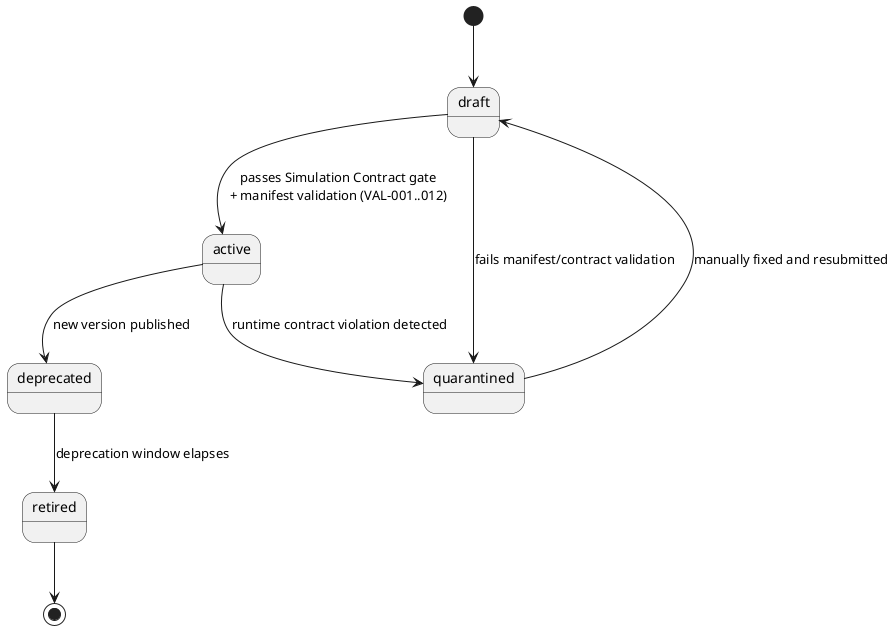
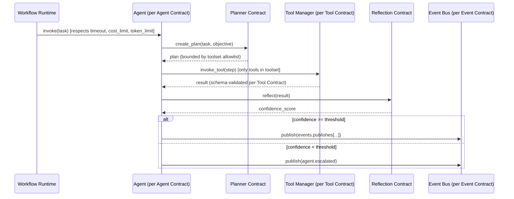

# Agent Contract Lifecycle & Invocation Flow

## Lifecycle (PlantUML state diagram)

## Invocation Sequence (Mermaid)

This flow is a contract-level description of _what must be true at each hop_, not an implementation sequence — actual runtime code is out of scope for this document per the Contract-First mandate.
