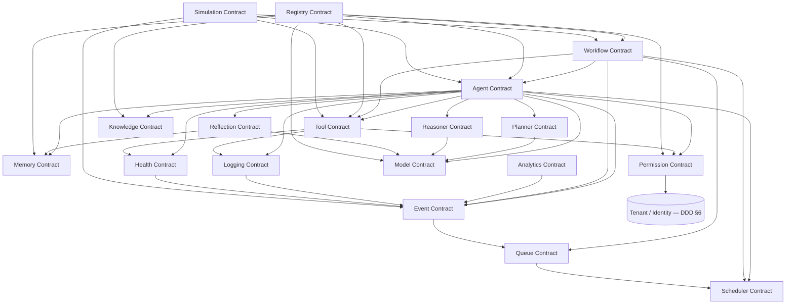

# Contract Dependency Graph

Governs: [`003.5-CONTRACT-FIRST-DESIGN.md`](../docs/003.5-CONTRACT-FIRST-DESIGN.md) §22

## Mermaid



## ASCII (fallback view)

```
                         Registry Contract
                                │
        ┌───────────┬──────────┼───────────┬────────────┐
        ▼           ▼          ▼           ▼            ▼
      Agent ◄──── Workflow   Model     Permission     Knowledge
        │           │          ▲           ▲
        ├─▶ Planner ┤          │           │
        ├─▶ Reasoner┼──────────┘           │
        ├─▶ Reflection                     │
        ├─▶ Memory                         │
        ├─▶ Tool ───────────────────────────┘
        ├─▶ Scheduler ──▶ Queue ──▶ Event
        ├─▶ Health ──▶ Event
        ├─▶ Logging ──▶ Event
        └─▶ Metrics (Analytics Contract) ◄── Event

  Simulation Contract (sandboxed, read-only) ──▶ Agent, Workflow, Tool, Event
```

**Reading order for implementers:** Registry → Permission/Identity → Model → Memory/Knowledge → Tool → Planner/Reasoner/Reflection → Agent → Workflow → Event/Queue/Scheduler → Health/Logging/Analytics → Simulation. This is also the recommended Core Runtime build order referenced in §31 of the DDD document and the TSR roadmap in the master Contract document.
