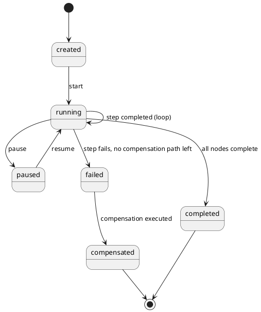

# Workflow Contract — State Machine

## PlantUML



## Node/Edge Model (ASCII)

```
Workflow
 ├─ nodes: [ {id, type: task|decision|parallel|compensation, ref} ... ]
 ├─ edges: [ {from, to, condition?} ... ]
 └─ execution:
        node(n1) ──edge(condition met)──▶ node(n2)
        node(n1) ──edge(condition met)──▶ node(n3)   (parallel_execution: true)
        node(n2), node(n3) ──join──▶ node(n4)
        node(n4) ──on failure──▶ compensation(n4)
```

This mirrors the Workflow Aggregate's node/edge structure defined in [`contracts/workflow.contract.md`](../contracts/workflow.contract.md) and DDD §17.3 State Machine.
